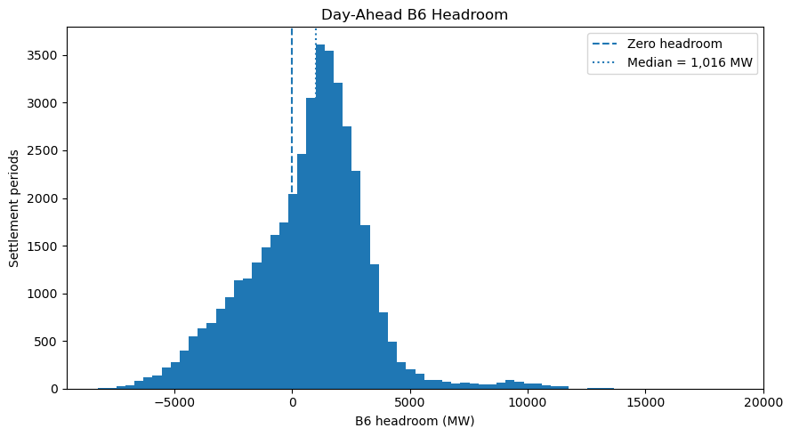
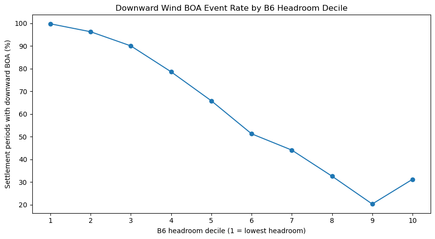
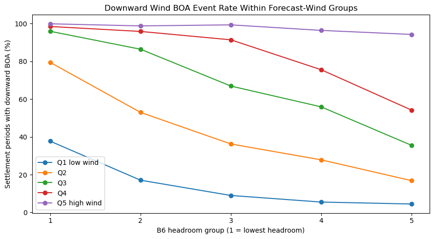
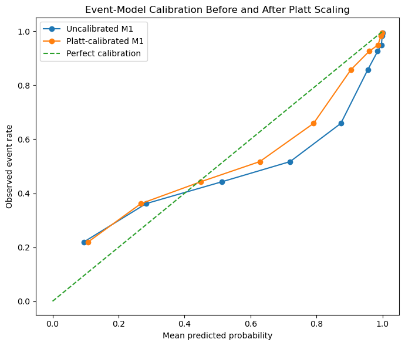

# B6 Transmission Headroom & Scottish Wind Balancing

**Commercial question:** When does Scottish wind generation face greater transmission-management risk?

**Empirical question:** Does published day-ahead B6/SCOTEX transmission headroom add historical predictive information about later Scottish downward wind Balancing Mechanism (BM) actions, beyond forecast wind, demand and calendar conditions?

Britain generates substantial wind power in Scotland, while much of its electricity demand is farther south. The transmission system cannot always accommodate the resulting north–south transfers. I investigated whether NESO's B6 boundary forecasts contain a useful signal about subsequent Scottish wind reductions, **without assuming that every downward wind action was caused by B6**.

> **Main finding:** On the historical periods with verified wind forecasts, adding B6 headroom improved prediction of whether *any* mapped Scottish wind downward BM action occurred. The benefit persisted when I strengthened the wind-and-demand baseline. It was smaller for predicting the exact size of the action. The study is retrospective; it does not establish a fully operational day-ahead forecasting system.

## At a glance

| Measure | Finding |
|---|---:|
| Descriptive B6/Scottish wind sample | **42,332** settlement periods |
| Verified-wind modelling sample | **31,532** settlement periods |
| Earlier training sample | **25,198** periods, 525 represented days |
| Later evaluation sample | **6,334** periods, 132 represented days |
| Original event model: AUC, without → with B6 | **0.8171 → 0.8622** |
| Nonlinear benchmark: AUC, without → with B6 | **0.8171 → 0.8654** |
| Original two-part volume forecast: MAE, without → with B6 | **899.8 → 860.1 MW** |

The later evaluation observations span **7 October 2025 to 23 April 2026**, but only **132 of 199 calendar days** are represented. The evaluation period was inspected during research development, so all model comparisons reported below are **exploratory**, not a genuinely untouched prospective validation.

## Relationship to existing industry and research work

The physical mechanism is **not a new discovery**. NESO's [Scottish boundary analysis](https://www.neso.energy/publications/electricity-ten-year-statement-etys/electricity-transmission-network-requirements/scottish-boundaries) documents the importance of north–south transfers, including B6 and other Scottish boundaries. Commercial work also connects transmission constraints to balancing actions: for example, [Modo Energy's published Balancing Mechanism methodology](https://docs.modoenergy.com/pages/oct-2026/uk-europe/technical/bm_technical/) models constraint severity and balancing volumes using boundary-flow and capability information. Existing academic analysis, including [*Investigating Wind Energy Curtailment in Scotland* (2025)](https://www.mdpi.com/1996-1073/18/11/2777), likewise addresses Scottish wind curtailment.

This project therefore **does not claim to be the first to connect B6 constraints, Scottish wind and balancing actions**, nor does it establish a novel physical theory. Its narrower contribution is a documented, independently rerun historical test of *whether B6 headroom adds incremental predictive information for mapped Scottish-wind downward BM actions, beyond the tested wind, demand and calendar baselines*. This comparison is not a comprehensive benchmark against commercial forecasting systems, and its point-in-time limitations remain material.

## 1. What B6 headroom means

B6 is a key transmission boundary between Scotland and England. For settlement period \(t\), I use NESO's published forecast boundary flow and limit to calculate:

$$
H_t^{B6}=L_t^{B6}-F_t^{B6}
$$

Here \(L_t^{B6}\) is the published transfer limit and \(F_t^{B6}\) is the forecast flow in the published positive direction. Lower headroom suggests a tighter forecast transfer position. **Negative published headroom is not proof of a realised physical overload**: forecast flow, network management and actual dispatch are different things.

The outcome is the total downward BM action recorded for mapped Scottish wind Balancing Mechanism Units (BMUs) in each settlement period. For the event model, the target equals one whenever that recorded downward volume is positive. **It does not label which action was caused by B6**, and it does not distinguish trivial from unusually large events.

## 2. Reconstructing the data

I combined NESO's day-ahead constraint flows and limits, wind forecasts, demand forecasts, Scottish wind BMU mappings and accepted wind BM actions. Data were organised in PostgreSQL `raw`, `core`, `audit` and `mart` layers. The principal modelling dataset is `mart.model_verified_wind`.

The initial NESO constraint file contained **728,529 rows across 31 constraint groups**. The SCOTEX/B6 data underwent exact-duplicate handling, completeness checks and settlement-period alignment. I focus the main investigation on the methodology regime **from 22 April 2024**, when NESO changed its published day-ahead flow approach.

**Important data-engineering finding from the final audit:** The raw data retain both occurrences of the autumn repeated clock hour, but the downstream transformation from `mart.scotex_primary_sample` to `mart.b6_primary_sp` excludes both audited 50-period autumn clock-change dates. Both 46-period spring clock-change dates survive. The original transformation SQL is unavailable, so the precise faulty rule has not been recovered. I report this explicitly rather than describing the full pipeline as DST-complete.

## 3. The descriptive pattern—and why controls matter

In the descriptive sample, lower B6 headroom is associated with more downward Scottish wind activity. For example, the lowest-headroom decile has a **99.8%** event rate and average downward BOA volume of **3,638 MW**, compared with **20.4%** and **189 MW** in decile nine. The highest-headroom decile rebounds, partly coinciding with unusual high-limit states and opposite-direction flows; the relationship is not simply monotonic across all regimes.

But strong wind can simultaneously increase potential north–south transfers and increase the wind generation available to be turned down. That is why the descriptive association alone cannot show that B6 contains *additional* predictive information. The main test controls for wind, demand and calendar information.

In the highest forecast-wind grouping, an event is already recorded in almost every observed period, so additional signals have little room to improve binary event prediction. This is a reason to examine performance by operating conditions rather than assume one fixed threshold applies every day.

## 4. Predictive comparison

The original analysis compares logistic classifiers using forecast wind, forecast demand and calendar variables (M0) against the same specification with B6 headroom added (M1). After reproducing that result from the recovered PostgreSQL model export, I challenged it with a nonlinear wind-and-demand baseline (M2) and its B6-enhanced equivalent (M3). M4 lets the B6 relationship be nonlinear and adds an indicator for the unusual 10,000 MW limit regime.

All models use the **same chronological training and evaluation split**. The additional models were evaluated on a period already examined during development; M4 must not be presented as a fresh confirmatory model-selection winner.

| Event model | ROC AUC ↑ | Average precision ↑ | Brier ↓ | Log loss ↓ |
|---|---:|---:|---:|---:|
| M0 — Original controls | 0.8171 | 0.9088 | 0.1720 | 0.5302 |
| M1 — Original controls + B6 | **0.8622** | **0.9359** | **0.1494** | **0.4748** |
| M2 — Nonlinear controls | 0.8171 | 0.9101 | 0.1689 | 0.5085 |
| M3 — Nonlinear controls + B6 | **0.8654** | **0.9369** | **0.1444** | **0.4568** |
| M4 — Nonlinear controls + flexible B6 | 0.8791 | 0.9436 | 0.1354 | 0.4334 |

Relative to M2, adding B6 in M3 improves AUC by **0.0483**. A paired, day-level bootstrap with 500 resamples gives an *approximate* 95% interval of **+0.0266 to +0.0733** on this evaluation sample. That interval does not account for the evaluation period's repeated inspection or guarantee out-of-period performance.

A separate histogram gradient-boosting comparison also improved when B6 was added (AUC **0.8058 → 0.8761**). That supports the conclusion that the observed B6 gain is not exclusive to one logistic specification. It does **not** establish superiority to every possible benchmark.

### Performance varies by conditions

The improvement is uneven. B6 adds comparatively little probability-accuracy improvement in the highest wind group, where downward actions are already very common. Month-by-month results also vary, and October/November have particularly limited date coverage. The model should not be marketed as equally useful across all operating regimes.

## 5. Predicting the volume is a harder problem

The original research also used a two-part model: a calibrated probability of any downward action multiplied by the expected volume conditional on an action occurring. The original comparison gave **899.8 MW** mean absolute error without B6 against **860.1 MW** with B6, an improvement of approximately **4.4%**. The later evaluation-period B6 forecast nevertheless overpredicted mean volume (approximately **1,780 MW forecast** against **1,549 MW observed**).

These volume results come from the **original research notebook/report**. The new independently rerun benchmark package tests **event occurrence**, not a new, stronger two-part volume comparison. We should not transfer the new event-model robustness results to the volume model.

## 6. What we learned during the final audit

The full modelling mart contains **42,332** periods; the verified-wind mart contains **31,532**. During the later evaluation window, **67 of 199 calendar days are absent** from the verified-wind model:

- **62 days (2,976 periods)** occur in the full mart but have no qualifying previous-day wind forecasts in the retained wind source. Later-dated records were not used to fill this gap.
- **Five additional dates** are absent from the full B6 mart. Four relate to missing/incomplete B6 source records; 26 October 2025 contains 50 usable raw B6 observations but is excluded by the autumn clock-change processing issue.

The included and excluded full-mart evaluation periods are not identical. Included periods have a downward-BOA event rate of **69.1%**, compared with **65.5%** in the excluded periods; mean B6 headroom is approximately **234 MW** versus **797 MW**. This raises a **sample-selection concern**, not proof of biased model results. The reported predictive performance applies to the observed subset, not necessarily all days in the calendar interval.

For each retained model observation, the stored wind and value-matched demand forecasts passed a candidate **18:00 Europe/London previous-day** timestamp check; wind timestamps were interpreted as UTC. This is a timestamp ordering check, **not proof that each forecast was publicly accessible at that exact time**.

Most importantly, the historical **first-publication and revision history for B6 flows/limits is unverified**. The raw B6 CSV has delivery-time fields but no observation-level historical release timestamps. NESO's stated approximate weekday publication target cannot certify every historical snapshot. Accordingly, this research establishes **retrospective predictive information**, not a point-in-time validated trading or dispatch system.

For the full validation trail, see the [methods and limitations appendix](https://github.com/jauricestudios/jauricestudios.github.io/blob/main/projects/b6-transmission-headroom/docs/methods_and_audit.md).

## 7. Commercial interpretation and boundaries

The practical interpretation is that publicly described day-ahead transmission conditions contain useful *historical information* about whether Scottish downward wind balancing actions occur, even after accounting for system-wide wind and demand forecasts. It suggests a direction for further constraint-risk monitoring, not a demonstrated trading strategy, financial saving or validated forecast at a fixed daily decision time.

This matters because predicting **whether** downward balancing occurs is different from identifying **how much** curtailment is materially costly, **which boundary** caused an action, or **who** bears a financial consequence.

**What this research does not establish:** B6-caused BOA attribution; physical line overload; generator-specific instruction prediction; an economically optimised action rule; live day-ahead availability for every historical date; or future forecasting performance.

## Reproduce and inspect

- [Original Jupyter notebook](https://github.com/jauricestudios/jauricestudios.github.io/blob/main/projects/b6-transmission-headroom/01_b6_analysis.ipynb)
- [Original full research report (PDF)](b6-transmission-headroom/B6_report.pdf) — dated 2 October 2026; see the [subsequent corrections and qualifications](https://github.com/jauricestudios/jauricestudios.github.io/blob/main/projects/b6-transmission-headroom/docs/errata_to_2026_report.md)
- [Benchmark reproduction instructions](https://github.com/jauricestudios/jauricestudios.github.io/blob/main/projects/b6-transmission-headroom/README.md)
- [Technical audit and provenance](https://github.com/jauricestudios/jauricestudios.github.io/blob/main/projects/b6-transmission-headroom/docs/methods_and_audit.md)

**Reproducibility scope:** The independent benchmark can be rerun from the exported model-ready CSV and Python scripts **when that CSV is provided locally**. The public publication patch does not redistribute the derived input data until the relevant permissions and attribution are reviewed. The original ad hoc PostgreSQL SQL used to populate the intermediate tables was not recovered; this is **not** complete raw-to-model reproduction.

## Primary data and context sources

- [NESO Day Ahead Constraint Flows and Limits](https://www.neso.energy/data-portal/day-ahead-constraint-flows-and-limits)
- [NESO Historic Day Ahead Wind Forecasts](https://www.neso.energy/data-portal/day-ahead-wind-forecast/historic_day_ahead_wind_forecasts)
- [NESO Wind BMU BOA Volumes](https://www.neso.energy/data-portal/wind-bmu-boa-volumes)
- [NESO Day Ahead Half Hourly Demand Forecast Performance](https://www.neso.energy/data-portal/day-ahead-half-hourly-demand-forecast-performance)
- [NESO Electricity Ten Year Statement — Scottish boundaries](https://www.neso.energy/publications/electricity-ten-year-statement-etys/electricity-transmission-network-requirements/scottish-boundaries)
- [Elexon BSC arrangements](https://bscdocs.elexon.co.uk/guidance-notes/the-balancing-and-settlement-code-bsc-arrangements)
