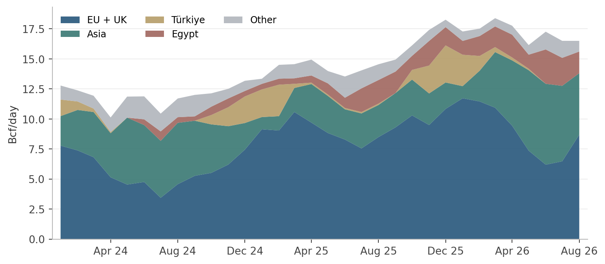
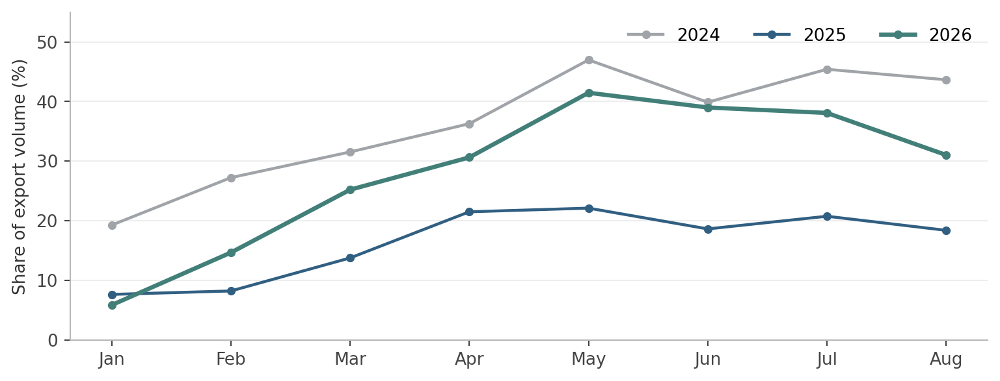
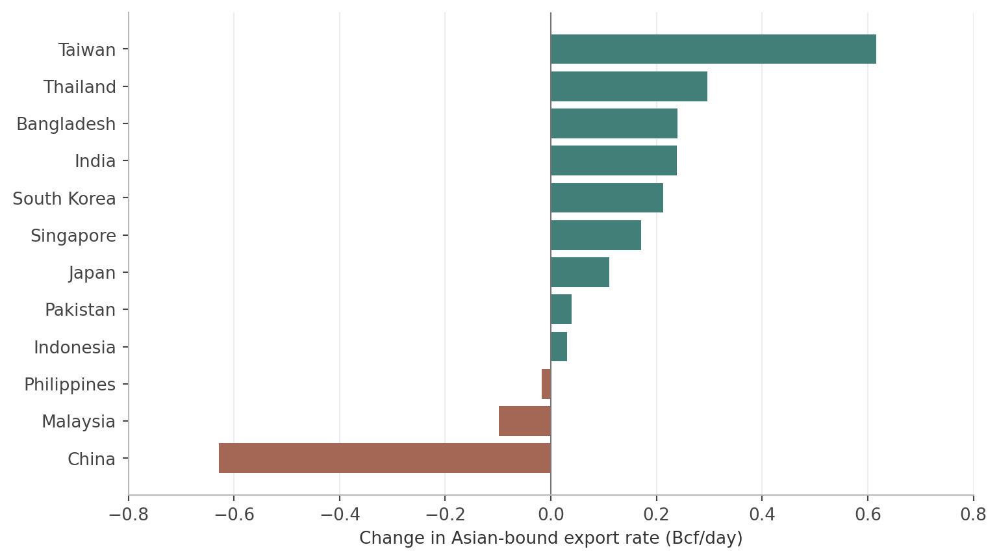
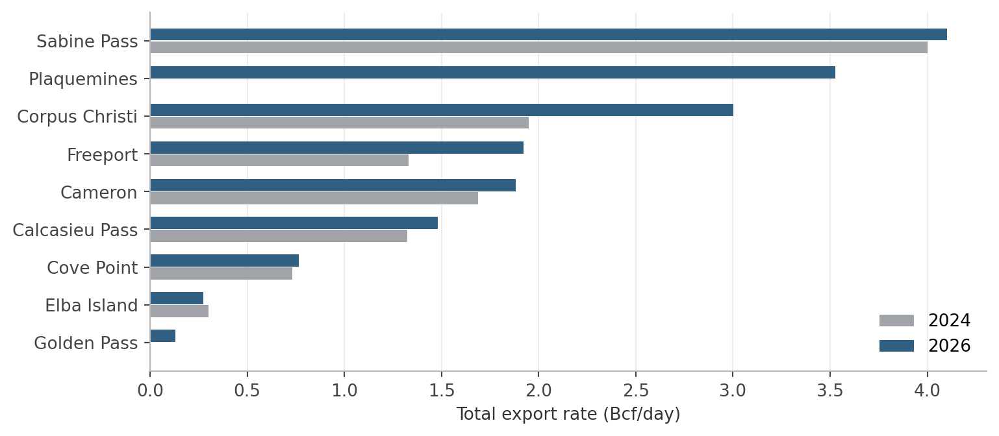

# US LNG Exports & Trade Flow Analysis

January 2024 – August 2026

How did US LNG export volumes and destinations change in 2026 compared with previous years?

This project uses US Department of Energy (DOE) export data to examine monthly flows, destination shares and differences across countries and export locations. A short Excel exercise compares published LNG destination assessments.

[Research note (PDF)](https://github.com/jauricestudios/atlantic-lng-research/blob/main/publication/US_LNG_Export_Analysis.pdf) · [Excel analysis](https://github.com/jauricestudios/atlantic-lng-research/raw/refs/heads/main/publication/US_LNG_Export_Analysis.xlsx)

[Python research repository](https://github.com/jauricestudios/atlantic-lng-research)

## Data

The [DOE export detail](https://www.energy.gov/hgeo/articles/natural-gas-imports-and-exports-monthly-2026) was restricted to January 2024–August 2026: 4,360 reporting rows, nine export locations and 45 destination countries. The cleaned panel contains 2,439 terminal-country-month records. Volumes are expressed in Bcf/day using calendar days.

Python was used for aggregation, historical comparisons and the volume/share decomposition. The Excel workbook contains the cleaned records, formula-based summaries, a regional pivot table and a small published-netback sensitivity exercise.

## Results

Asian-bound exports averaged 5.81 Bcf/day in March–August 2026, up from 1.75 in January–February. Total covered exports fell slightly over the same comparison, from 17.39 to 17.09 Bcf/day.

The Asian share rose more sharply within 2026 than in either comparison year, but remained below the corresponding 2024 month throughout January–August.

Taiwan recorded the largest positive change (+0.62 Bcf/day), while China's recorded volume fell by 0.63 Bcf/day. The regional increase masks quite different country-level movements.

Plaquemines and Golden Pass accounted for about 73% of the net increase in Asian-bound export rates versus the matched 2024 period. Higher overall exports contributed more to that increase than changes in destination shares.

## Destination economics

The workbook also compares three published market snapshots for delivery to Northeast Asia versus Europe. In the April example, an additional Panama cost of $0.533/MMBtu removes the assessed advantage over Europe, holding other values fixed. This is a sensitivity exercise, not a historical trading strategy.

## Notes

The data describe reported export destinations rather than individual cargo diversions. The commercial assessments are selected examples with different valuation conventions; they are not a continuous historical series. Definitions, calculations and original sources are in the PDF and Excel workbook.

The physical analysis uses the frozen DOE panel from commit `cc31968`. The raw source workbook is obtained separately from DOE. AI assistance was used in code development, analytical methodology, workbook and report preparation.
